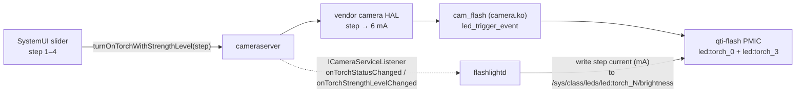

# OxygenOS / ColorOS Flashlight Intensity Fix

Makes the **flashlight brightness slider** (Quick Settings → long-press Flashlight) actually change
the torch brightness on **OxygenOS / ColorOS ports** running on non-OnePlus/OPPO hardware.

On these ports all four slider steps produce the *same* very dim light (6 mA per LED). This fix is
a small native C++ daemon, `flashlightd`, that listens to the camera service and drives the
Qualcomm PMIC torch LEDs with a proper current for each slider step:

| Slider step | Before | After |
|:-----------:|:------:|:-----:|
| 1 | 6 mA | **19 mA** |
| 2 | 6 mA | **38 mA** |
| 3 | 6 mA | **75 mA** |
| 4 | 6 mA | **150 mA** |

*(per LED channel; the device has two, so total torch current is double)*

No Xposed/LSPosed, no SystemUI patching, no Magisk/KernelSU module, no shell scripts, no config
file: one C++ binary plus one init `.rc`.

---

## The bug

OxygenOS and ColorOS share the same OPlus SystemUI. Its flashlight code
(`com.android.systemui.statusbar.policy.FlashlightControllerImpl`) does this:

1. **`getCameraId()`** decides whether the brightness slider is supported. It first reads the OPlus
   camera vendor tag **`com.oplus.flashStrengthEnable`**. On OnePlus/OPPO hardware the OPlus camera
   HAL publishes it and translates slider *steps* into tuned LED currents itself.
2. On a port with another vendor's camera HAL (Xiaomi's here), that tag doesn't exist. The lookup
   throws, the exception is swallowed (`"Couldn't get."`), and the code falls back to the AOSP key
   `FLASH_INFO_STRENGTH_MAXIMUM_LEVEL` (= **100**), so the slider is enabled anyway.
3. The slider (`OplusQSFlashlightLevelView`) has **4 steps** (only 2 under thermal torch-limit or
   Super Power Saving). The chosen step is passed **unscaled** to
   `CameraManager.turnOnTorchWithStrengthLevel(cameraId, step)`.
4. The foreign HAL reads 1–4 as "1–4 out of 100". Measured on the test device (Xiaomi CamX HAL):

   | HAL level | 1 | 2 | 3 | 4 | 10 | 25 | 50 | 75 | 100 |
   |---|---|---|---|---|---|---|---|---|---|
   | mA per channel | 6 | 6 | 6 | 6 | 6 | 15 | 30 | 45 | 60 |

   The HAL maps **0.6 mA per level with a 6 mA floor**, so every slider step lands on 6 mA.

You can confirm you have this bug:

```bash
adb shell dumpsys media.camera | grep -A1 "strengthMaximumLevel\|flashStrengthEnable"
adb logcat -s CameraService | grep turnOnTorchWithStrengthLevel   # then move the slider
```

If `strengthMaximumLevel` is large (e.g. 100), there is no `com.oplus.flashStrengthEnable`, and the
slider logs `changed to 1` … `changed to 4`, this fix applies.

## How the fix works



* `flashlightd` registers an `android.hardware.ICameraServiceListener` with `cameraserver` over raw
  binder (`libbinder_ndk`). That is the same event stream SystemUI's `TorchCallback` uses.
* When a torch is lit at level 1–4 (a SystemUI step), it programs the torch channels behind the
  camera's LED switch with the mapped current. It re-checks briefly afterwards because the HAL can
  land its own write a few milliseconds late.
* The HAL still believes it is at step N, so `cameraserver` keeps reporting step N and **the slider
  UI stays in sync**. No reverse mapping is needed.
* Levels 5–100 (third-party torch apps) are left to the HAL untouched.
* Torch on/off stays with the HAL. The daemon **never writes `0`** to a `brightness` node, because
  that detaches the camera driver's LED trigger until reboot.

### Hardware discovery and safety

Nothing about the LEDs is hard-coded beyond the switch name:

* **Channels:** the `qcom,led-mask` of `led:switch_0` in the device tree selects the torch channels
  (here mask `0x9` → `led:torch_0`, `led:torch_3`).
* **Limits:** `max_brightness` gives each channel's ceiling (300 mA). Xiaomi's kernel derate table
  (`xiaomi,currents-with-time` / `xiaomi,time-for-currents`) gives the current allowed indefinitely
  (**150 mA**). Above that the kernel drops the current back after 5 s.
* **Curve:** the brightest step equals that sustained limit and each lower step halves it
  (`sustained × 2^(step − steps)`). Equal ratios look like equal steps to the eye, and nothing ever
  exceeds the thermal limit.

## Tested on

| | |
|---|---|
| Device | POCO F7 (`onyx`), Qualcomm `sun` platform, PMXR2230 flash LED (`qcom,qti-pm8350c-flash-led`) |
| ROM | OxygenOS 16.0.10.501 port (CPH2573), Android 16 / SDK 36, SystemUI 16.99.12 |
| Kernel | 6.6 GKI (android15-8) |
| Root | KernelSU Next, SELinux **permissive** |

It should work on other OxygenOS **and** ColorOS ports with the same combination: a camera HAL
without the OPlus flash tags and a Qualcomm `qti-flash` PMIC torch. Stock OnePlus/OPPO phones don't
have this bug and don't need it.

> **Android version:** `ICameraService` is not an NDK-stable interface, and this build is pinned to
> the **Android 16** transaction codes (`addListener=5`, `turnOnTorchWithStrengthLevel=17`,
> `getTorchStrengthLevel=18`; listener `onTorchStatusChanged=3`, `onTorchStrengthLevelChanged=4`).
> On another Android version, check the `TRANSACTION_*` constants in your `framework.jar`
> (`android.hardware.ICameraService$Stub`) and open an issue if they differ.

## Install

Requirements: root, `adb`, and a `/vendor` that can be remounted read-write (ext4 without
`shared_blocks`, dm-verity disabled). Otherwise use [Run without installing](#run-without-installing).

This repository mirrors the device's `/vendor` layout: [`vendor/bin/flashlightd`](vendor/bin/flashlightd)
(prebuilt arm64 binary) and [`vendor/etc/init/flashlightd.rc`](vendor/etc/init/flashlightd.rc).
**ROM porters** can drop the `vendor/` tree straight into the port's vendor image. On a running
phone:

```bash
adb push vendor/bin/flashlightd /data/local/tmp/flashlightd
adb push vendor/etc/init/flashlightd.rc /data/local/tmp/flashlightd.rc
adb shell
```
```bash
su -M
mount -o remount,rw /vendor          # if refused: blockdev --setrw <dm device of /vendor> first
cp /data/local/tmp/flashlightd    /vendor/bin/flashlightd
cp /data/local/tmp/flashlightd.rc /vendor/etc/init/flashlightd.rc
chown root:shell /vendor/bin/flashlightd && chmod 0755 /vendor/bin/flashlightd
chmod 0644 /vendor/etc/init/flashlightd.rc
chcon u:object_r:vendor_file:s0         /vendor/bin/flashlightd
chcon u:object_r:vendor_configs_file:s0 /vendor/etc/init/flashlightd.rc
sync && mount -o remount,ro /vendor
reboot
```

After boot, init starts `vendor.flashlightd` in `class late_start` and restarts it if it ever exits:

```bash
adb shell getprop init.svc.vendor.flashlightd     # -> running
adb shell su -c flashlightd status
```

> **SELinux:** [`vendor/etc/init/flashlightd.rc`](vendor/etc/init/flashlightd.rc) runs the daemon as user `system` in
> KernelSU's `u:r:su:s0` domain, which works on permissive ports. On an **enforcing** build, give it
> a proper domain (`type flashlightd, domain; init_daemon_domain(flashlightd)`, plus a file context
> for `/vendor/bin/flashlightd`, `binder_call` with `cameraserver` and write access to the LED
> sysfs nodes) and drop the `seclabel` line.

### Run without installing

The binary manages itself like an init service. `start` detaches a supervisor that restarts the
daemon whenever it exits:

```bash
adb push vendor/bin/flashlightd /data/local/tmp/
adb shell su -c "mkdir -p /data/adb/flashlightd && cp /data/local/tmp/flashlightd /data/adb/flashlightd/ && chmod 755 /data/adb/flashlightd/flashlightd"
adb shell su -c "/data/adb/flashlightd/flashlightd start"
```

This doesn't survive a reboot. Run `start` again after each boot.

## Usage

```
flashlightd start | stop | restart      manage the service (drives init's ctl.start/ctl.stop when the .rc is installed)
flashlightd status                      service state, torch channels, step table, HAL level
flashlightd daemon                      run in the foreground
flashlightd set <mA>                    write a current to the torch channels (debug)
flashlightd torch on [level] [hold_ms]  light the torch through cameraserver exactly like SystemUI (test)
flashlightd torch off | torch level
```

Logs: `adb logcat -s flashlightd`

## Checking compatibility

Settings are compiled into the binary: LED switch `led:switch_0`, 4 slider steps, and the curve
above. Torch channels and current limits are discovered from your device tree at startup. Run
this before installing:

```bash
adb push vendor/bin/flashlightd /data/local/tmp/ && adb shell su -c "/data/local/tmp/flashlightd status"
```

It should list your torch channels (for example `led:torch_0`, `led:torch_3`) with their max and
sustained currents, and the step → mA table. If no channels are found, your device uses a
different LED switch or flash driver. Open an issue with the output of
`ls /sys/class/leds` and `flashlightd status`.

## Uninstall

```bash
adb shell su -M -c "mount -o remount,rw /vendor && rm /vendor/bin/flashlightd /vendor/etc/init/flashlightd.rc && mount -o remount,ro /vendor"
adb reboot
```

## Repository contents

```
vendor/bin/flashlightd   the daemon + CLI (arm64, Android 16, NDK-built C++)
vendor/etc/init/flashlightd.rc   init service definition
```

## Disclaimer

This changes the current driven through your phone's flash LEDs. It stays within the limits your
kernel exposes (never above the sustained current, never above `max_brightness`), but you use it
at your own risk.
